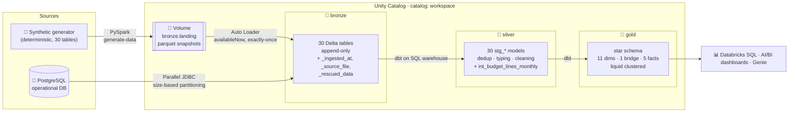
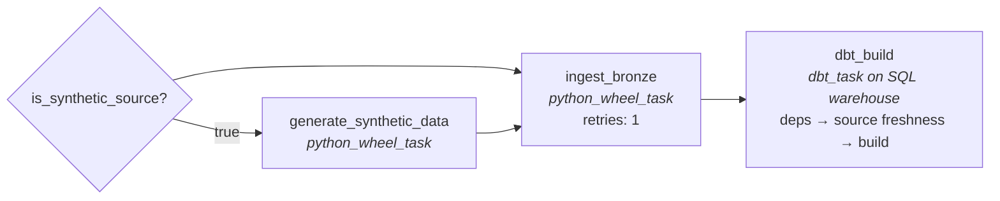
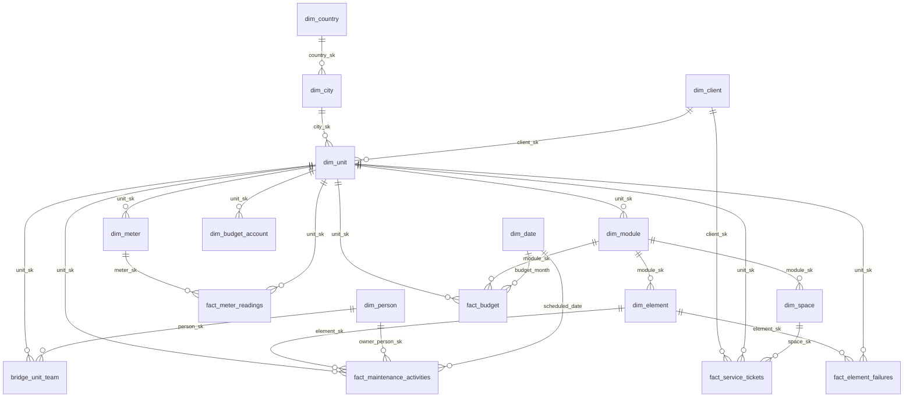

<div align="center">

# 🏗️ FacilityOps Medallion Lakehouse on Databricks

**An end-to-end, production-style data platform on Databricks: Auto Loader & JDBC ingestion, a dbt-built medallion architecture on Unity Catalog, and a star schema answering real operational questions, all deployed as code with Databricks Asset Bundles on serverless compute.**

[](https://github.com/jjclinares/medallion_arq_ingest/actions/workflows/ci.yml)


</div>

---

## 📌 At a glance

**🧭 Project type:** Data engineering. A *lakehouse* (a modern data platform) built on Databricks, from raw data to business-ready tables.

**💡 In one sentence:** it takes the messy operational data of a facility-management company and turns it into clean, tested tables that answer real questions about maintenance, failures, service tickets, budgets and utility use.

**🔄 How it works, in 3 steps (the "medallion" pattern):**

| Step | Layer | What happens | Tool |
|---|---|---|---|
| 1️⃣ | 🥉 **Bronze** | Raw data arrives untouched, with an audit trail | PySpark, Auto Loader, JDBC |
| 2️⃣ | 🥈 **Silver** | Data is cleaned, typed and de-duplicated | dbt |
| 3️⃣ | 🥇 **Gold** | A star schema ready for dashboards and analysis | dbt |

**✅ What it shows:**
- Incremental, re-runnable loads that never duplicate data
- Data-quality tests that stop bad data before it reaches reports
- The whole platform deployed as code, with automated checks on every change
- Everything runs without any outside database, using a built-in synthetic data generator

**🧰 Environment**


**🚀 Jump to:** [Architecture](#architecture) · [Quick start](#quick-start-databricks-free-edition-works) · [Gold data model](#gold-data-model) · [Design decisions](#design-decisions)

> 📖 Everything below is the full technical detail of the same project.

---

## Table of contents

- [At a glance](#-at-a-glance)
- [The business problem](#the-business-problem)
- [Architecture](#architecture)
- [Databricks features used](#databricks-features-used)
- [The medallion layers](#the-medallion-layers)
- [Gold data model](#gold-data-model)
- [Interesting engineering problems](#interesting-engineering-problems)
- [Quick start](#quick-start-databricks-free-edition-works)
- [Configuration](#configuration)
- [Local development](#local-development)
- [Data quality & CI/CD](#data-quality--cicd)
- [Repository structure](#repository-structure)
- [Design decisions](#design-decisions)
- [Roadmap](#roadmap)

---

## The business problem

**FacilityOps** is a (fictional) property & facility-management company. It operates office towers, malls, hospitals and campuses across six countries. Its operational platform tracks **buildings, equipment, preventive-maintenance plans, failures, utility meters, service-desk tickets and budgets**. It does not answer questions like these:

| Question | Answered by |
| --- | --- |
| Are technicians executing preventive maintenance **on time**, or silently skipping it? | `fact_maintenance_activities` |
| How many **service hours** did each failure actually cost, given the equipment's operating window? | `fact_element_failures` |
| Is the service desk meeting its **response and resolution SLAs**? | `fact_service_tickets` |
| How is each building executing its **budget**, month by month and chapter by chapter? | `fact_budget` |
| What is the **utility consumption** per building and meter? | `fact_meter_readings` |

This project builds the lakehouse that answers them. A built-in **synthetic data generator** reproduces the source system, including its messy parts (stray whitespace, inconsistent casing, zero placeholders, rescheduled activities, meter resets). The whole platform therefore runs end-to-end in any Databricks workspace, including the free one, with no external database.

---

## Architecture



**Orchestration**: one Databricks Job, defined in [`resources/medallion_pipeline.job.yml`](resources/medallion_pipeline.job.yml) and running entirely on **serverless**:



---

## Databricks features used

| Feature | Where | Why |
| --- | --- | --- |
| **Unity Catalog** (catalog / schemas / volumes) | everywhere | Governed 3-level namespace; `bronze`, `silver`, `gold` schemas; landing & checkpoint **Volumes** instead of DBFS. |
| **Auto Loader** (`cloudFiles`) | [`autoloader.py`](src/medallion_ingest/autoloader.py) | Incremental, exactly-once file ingestion with checkpoints; contract schemas plus `_rescued_data` so schema drift never breaks the pipeline. |
| **Structured Streaming `availableNow`** | `autoloader.py` | Streaming semantics with batch economics; required on serverless. |
| **Parallel JDBC reads** | [`jdbc.py`](src/medallion_ingest/jdbc.py) | Partition count derived from `pg_total_relation_size`, so large tables are read by many tasks in parallel. |
| **Secret scopes** | `jdbc.py` | Database credentials never live in code or job parameters. |
| **Delta Lake** | all tables | ACID, time travel, `MERGE`. |
| **Liquid clustering** | gold facts, `stg_meter_readings` | Replaces partitioning + Z-ORDER; clustered on date + unit / meter for typical filters. |
| **Incremental `MERGE`** | [`stg_meter_readings`](dbt/models/silver/stg_meter_readings.sql) | Only rows ingested since the last run are processed. |
| **dbt-databricks on a SQL warehouse** | [`dbt/`](dbt/) | SQL transformations with lineage, docs (persisted to UC comments) and tests. |
| **Databricks Asset Bundles** | [`databricks.yml`](databricks.yml) | Infrastructure-as-code: wheel build, job, environments, `dev`/`prod` targets. |
| **Serverless jobs & environments** | job YAML | No clusters to size or manage; dependencies declared per task. |
| **Condition tasks & `run_if`** | job YAML | Same job supports synthetic, landing-only and PostgreSQL sources. |
| **Development mode** | `dev` target | Per-developer schemas (`dev_<user>_silver`), paused schedules, prefixed job names. |

---

## The medallion layers

### 🥉 Bronze: raw, append-only, auditable
*Python package [`medallion_ingest`](src/medallion_ingest/), deployed as a wheel.*

- **Two interchangeable sources** behind one CLI (`ingest-bronze --source synthetic|landing|postgres`):
  - **Auto Loader** reads parquet snapshots from `/Volumes/<catalog>/bronze/landing/<table>/<run_id>/`.
  - **JDBC** pulls PostgreSQL directly. Small tables use one query; large ones are split into range reads on the primary key, sized from table statistics.
- Every row gets **lineage columns**: `_ingested_at`, `_source_file` and `_rescued_data` (columns that didn't match the contract).
- Tables are ingested **concurrently**. A failure in one table doesn't stop the others, but the task still fails at the end so the job surfaces it.
- The [source contract](src/medallion_ingest/schemas.py) (Spark DDL per table) is shared by the generator, Auto Loader and the tests.

### 🥈 Silver: clean, typed, deduplicated
*dbt models [`stg_*`](dbt/models/silver/), one per source table.*

- **Latest-record deduplication** of the append-only bronze history (the [`latest_records`](dbt/macros/latest_records.sql) macro: `QUALIFY ROW_NUMBER() OVER (PARTITION BY id ORDER BY _ingested_at DESC) = 1`).
- **Standardisation** through reusable macros: trimming, empty string → `NULL`, `0` placeholders → `NULL`, case normalisation, and enum codes → labels (`preventive_maintenance` → `Preventive Maintenance`).
- **Parsing** free-text fields, e.g. equipment service windows `'mon_fri'` / `'22-00_06-00'` → `array<int>` ISO weekdays + minutes after midnight.
- **Reshaping**: [`int_budget_lines_monthly`](dbt/models/silver/int_budget_lines_monthly.sql) `UNPIVOT`s 24 wide month columns into a long table.
- Reference data as **seeds** ([recurrence rules](dbt/seeds/activity_frequencies.csv), [budget chapter types](dbt/seeds/budget_chapter_types.csv)).

### 🥇 Gold: business-ready star schema
*dbt models in [`dbt/models/gold/`](dbt/models/gold/), documented, tested and liquid clustered.*

Conformed dimensions with stable surrogate keys, five fact tables, and a bridge table for the many-to-many unit ↔ team relationship. Model and column descriptions are **persisted to Unity Catalog**, so they appear in Catalog Explorer and help Genie / AI/BI answer questions.

---

## Gold data model



| Fact | Grain | Key measures |
| --- | --- | --- |
| `fact_maintenance_activities` | activity occurrence (plan × due date) | status, `days_late`, `is_planned_occurrence`, `is_registered` |
| `fact_element_failures` | equipment failure | `failure_hours`, `unavailable_hours`, status |
| `fact_meter_readings` | meter reading | `reading_value`, `consumption`, `is_meter_reset` |
| `fact_service_tickets` | ticket | `first_response_hours`, `resolution_hours`, SLA statuses |
| `fact_budget` | budget line × month | `planned_amount`, `spent_amount`, `variance_amount`, `execution_ratio` |

---

## Interesting engineering problems

<details open>
<summary><b>1 · Detecting maintenance that never happened</b></summary>

A skipped preventive activity leaves **no row** in the source: technicians simply never create it. To expose it, [`fact_maintenance_activities`](dbt/models/gold/fact_maintenance_activities.sql):

1. Expands every plan over a calendar using its recurrence rule. Fourteen frequencies (daily … quinquennial) reduce to three cadence units in a [seed](dbt/seeds/activity_frequencies.csv), including month-end clamping (a plan starting on the 31st is due on Feb 28).
2. `FULL OUTER JOIN`s these *expected* occurrences with the *registered* activities.
3. Classifies each row as **Closed on time / Closed late / Pending / Overdue**. Planned-but-never-created occurrences become *Overdue*, and off-plan work (rescheduled, ad-hoc) still counts.

The Python generator uses the [same rules](src/medallion_ingest/scheduling.py), and a unit test guarantees the Python rules and the dbt seed never drift apart.
</details>

<details>
<summary><b>2 · Downtime that respects operating hours</b></summary>

A 60-hour failure of an office chiller (Mon-Fri 08:00-18:00) over a weekend costs **zero** service hours. [`fact_element_failures`](dbt/models/gold/fact_element_failures.sql) explodes each failure into days (`explode(sequence(...))`), keeps only the element's service weekdays, builds each day's service window (including **overnight windows** such as 22:00-06:00 that cross midnight) and sums the overlap with the failure interval. A singular test asserts lost service time never exceeds failure duration.
</details>

<details>
<summary><b>3 · Wide-to-long budget reshaping without losing a cent</b></summary>

Budgets arrive as `planned_january … spent_december` columns, with chapter-level VAT in separate columns. A multi-column `UNPIVOT` (generated with a Jinja loop) turns items and taxes into one long table. A [singular test](dbt/tests/assert_budget_unpivot_preserves_totals.sql) checks that the reshaped totals equal the original wide totals.
</details>

<details>
<summary><b>4 · Consumption from cumulative meters</b></summary>

Meters report cumulative values. Consumption is the `LAG` delta per meter. A drop in the reading means the meter was replaced or reset, so it is flagged instead of producing a negative consumption.
</details>

<details>
<summary><b>5 · Honest SLAs</b></summary>

Tickets that are still open but already past their SLA are reported as **Breached** immediately, rather than staying "in progress" until someone closes them.
</details>

<details>
<summary><b>6 · Re-runnable, exactly-once ingestion</b></summary>

Every run lands a full snapshot in a new folder. Auto Loader checkpoints ensure each file is ingested exactly once, and silver deterministically keeps the latest version of each record. Running the job twice, or retrying a failed task, never duplicates data.
</details>

---

## Quick start (Databricks Free Edition works)

**Prerequisites**

- A Databricks workspace with Unity Catalog and serverless enabled. [Databricks Free Edition](https://www.databricks.com/learn/free-edition) is enough.
- A recent [Databricks CLI](https://docs.databricks.com/dev-tools/cli/install.html).
- [uv](https://docs.astral.sh/uv/), used by the bundle to build the wheel.

```bash
git clone https://github.com/jjclinares/medallion_arq_ingest.git
cd medallion_arq_ingest

# 1. authenticate (opens the browser)
databricks auth login --host https://<your-workspace>.cloud.databricks.com

# 2. validate & deploy the dev target (builds the wheel, uploads code, creates the job)
databricks bundle validate
databricks bundle deploy

# 3. run the whole pipeline: generate -> bronze -> silver -> gold
databricks bundle run medallion_pipeline
```

Then open **Catalog Explorer → `workspace` → `dev_<you>_gold`**, or query it from the SQL editor:

```sql
-- preventive-maintenance compliance per building, last 90 days
SELECT u.unit_name,
       count_if(a.status = 'Closed on time') / count(*) AS on_time_ratio,
       count_if(a.status = 'Overdue')                   AS overdue
FROM   workspace.dev_<you>_gold.fact_maintenance_activities a
JOIN   workspace.dev_<you>_gold.dim_unit u USING (unit_sk)
WHERE  a.scheduled_date >= current_date() - INTERVAL 90 DAYS
GROUP  BY ALL
ORDER  BY on_time_ratio;
```

More ready-made KPI queries live in [`dbt/analyses/`](dbt/analyses/): maintenance compliance, equipment reliability (MTTR), YTD budget execution and service-desk SLAs.

**Deploy to production**: `databricks bundle deploy -t prod` (schemas without prefix, schedule active).

---

## Configuration

All settings are bundle variables (`--var name=value`, or per target in `databricks.yml`):

| Variable | Default | Description |
| --- | --- | --- |
| `catalog` | `workspace` | Unity Catalog catalog for every layer. |
| `schema_prefix` | `dev_<user>_` in dev, empty in prod | Prefix for the `bronze` / `silver` / `gold` schemas. |
| `source` | `synthetic` | `synthetic` (generate + Auto Loader), `landing` (Auto Loader on files you drop in the volume) or `postgres` (JDBC). |
| `synthetic_scale` | `1` | Data volume multiplier (`1` ≈ 25 buildings / 20k rows; `20` ≈ 500 buildings). |
| `secret_scope` | — | Secret scope with `postgres-url`, `postgres-user`, `postgres-password` (`source=postgres`). |
| `warehouse_id` | lookup of *Serverless Starter Warehouse* | SQL warehouse that runs dbt. |

dbt behaviour is tuned with project vars in [`dbt_project.yml`](dbt/dbt_project.yml): the activity calendar window (`activity_lookback_days`, `activity_horizon_days`) and the default SLAs.

<details>
<summary><b>Ingesting from a real PostgreSQL database</b></summary>

```bash
databricks secrets create-scope facilityops
databricks secrets put-secret facilityops postgres-url       # jdbc:postgresql://host:5432/db
databricks secrets put-secret facilityops postgres-user
databricks secrets put-secret facilityops postgres-password

databricks bundle deploy --var source=postgres --var secret_scope=facilityops
databricks bundle run medallion_pipeline
```

The connector discovers tables and sizes from `pg_catalog`, reads tables above 128 MB in parallel ranges on `id`, and overwrites each bronze table with a fresh snapshot. The source tables must follow the [contract](src/medallion_ingest/schemas.py), or you can adapt the [dbt sources](dbt/models/bronze/_bronze__sources.yml). For production, also consider [Lakehouse Federation](https://docs.databricks.com/query-federation/) or Lakeflow Connect.
</details>

---

## Local development

```bash
uv sync                      # Python 3.12 env with pytest, ruff, dbt-databricks
uv run pytest                # generator, recurrence rules, config, JDBC planning
uv run ruff check . && uv run ruff format --check .

# generate the synthetic dataset in memory, without Spark
uv run python -c "from medallion_ingest.synthetic import generate; print({t: len(r) for t, r in generate().items()})"
```

**dbt against your workspace** (uses [`dbt/profiles/profiles.yml`](dbt/profiles/profiles.yml)):

```bash
export DATABRICKS_HOST=dbc-xxxx.cloud.databricks.com
export DATABRICKS_HTTP_PATH=/sql/1.0/warehouses/<id>
export DATABRICKS_TOKEN=<token>
export DBT_SCHEMA_PREFIX=dev_<you>_

cd dbt
uv run dbt deps  --profiles-dir profiles
uv run dbt build --profiles-dir profiles
uv run dbt docs generate --profiles-dir profiles && uv run dbt docs serve --profiles-dir profiles
```

**PySpark against your workspace**: `uv sync --group connect` installs Databricks Connect, and `get_spark()` picks it up automatically.

---

## Data quality & CI/CD

- **132 dbt data tests**: primary keys (`unique` + `not_null`) on every model, `relationships` from every fact to its dimensions, `accepted_values` on every status, plus two singular business-rule tests. `dbt build` runs them in DAG order, so a failing test stops downstream models from being built on bad data.
- **Source freshness**: the job fails if bronze hasn't been refreshed in 72 h.
- **74 Python unit tests** cover the generator's referential integrity across 43 foreign keys, determinism, scaling, the recurrence rules (including month-end and leap-year edge cases), identifier validation and JDBC partition planning.
- **[CI](.github/workflows/ci.yml)** on every PR runs ruff lint + format, pytest, the wheel build and `dbt parse`.
- **[CD](.github/workflows/deploy.yml)**: `databricks bundle deploy -t prod` on merge to `aws_migrations`. Enable it with the secrets `DATABRICKS_HOST` / `DATABRICKS_TOKEN` and the variable `DEPLOY_ENABLED=true`.

---

## Repository structure

```text
.
├── databricks.yml                      # Asset Bundle: artifacts, variables, dev/prod targets
├── resources/
│   └── medallion_pipeline.job.yml      # serverless job: generate → bronze → dbt
├── src/medallion_ingest/               # 🥉 bronze (Python wheel)
│   ├── cli.py                          #   entry points: generate-data, ingest-bronze
│   ├── schemas.py                      #   source contract (Spark DDL per table)
│   ├── synthetic.py                    #   deterministic FacilityOps data generator
│   ├── scheduling.py                   #   maintenance recurrence rules
│   ├── landing.py                      #   writes snapshots to the landing volume
│   ├── autoloader.py                   #   Auto Loader → bronze Delta
│   ├── jdbc.py                         #   PostgreSQL → bronze Delta (parallel JDBC)
│   ├── config.py · runtime.py          #   UC locations, Spark session, bootstrap
├── dbt/                                # 🥈🥇 silver & gold
│   ├── dbt_project.yml
│   ├── models/
│   │   ├── bronze/_bronze__sources.yml #   sources + freshness
│   │   ├── silver/                     #   30 stg_* models + int_budget_lines_monthly
│   │   └── gold/                       #   11 dims, 1 bridge, 5 facts (+ docs & tests)
│   ├── macros/                         #   dedup, text cleaning, time helpers, schema naming
│   ├── seeds/                          #   recurrence rules, budget chapter types
│   ├── tests/                          #   singular business-rule tests
│   ├── analyses/                       #   KPI queries
│   └── profiles/profiles.yml           #   local dev profile
├── tests/                              # pytest suite
└── .github/workflows/                  # CI and CD
```

---

## Design decisions

- **dbt on a SQL warehouse for silver/gold, PySpark for bronze.** Ingestion needs code (streams, JDBC partitioning, secrets); transformations are best expressed as tested, documented SQL. Running dbt on a serverless SQL warehouse gives Photon performance and per-query cost.
- **Append-only bronze, deduplicating silver.** Bronze is a faithful, replayable history (great for audits and backfills). The "current state" decision lives in one macro.
- **Explicit source contract plus `_rescued_data`.** Unexpected columns are kept, not lost, and never break the nightly run.
- **Natural-key surrogate keys** (`generate_surrogate_key(id)`). They are stable across runs, so downstream joins and BI bookmarks don't break when attributes change.
- **Liquid clustering instead of partitioning.** These tables are too small for partitioning to pay off, and clustering keys can evolve without rewriting the table.
- **Synthetic data with realistic defects.** A portfolio pipeline that only sees clean data proves nothing; the generator injects the problems silver has to solve.
- **Everything as code.** One `databricks bundle deploy` recreates the platform in any workspace, and `dev` mode gives every developer an isolated copy.

---

## Roadmap

- [ ] Databricks AI/BI dashboard and Genie space on top of gold, deployed with the bundle
- [ ] Snapshots (SCD Type 2) for units and elements with `dbt snapshot`
- [ ] Change Data Feed from silver to drive incremental gold facts
- [ ] Lakeflow Declarative Pipelines variant of bronze/silver with expectations
- [ ] Row filters & column masks on personal data (emails, phones) in Unity Catalog

---

<div align="center">

Built by **Jamer Jilver Castro Linares** · [GitHub @jjclinares](https://github.com/jjclinares)

*All company names, people and figures in this project are synthetic.*

</div>
